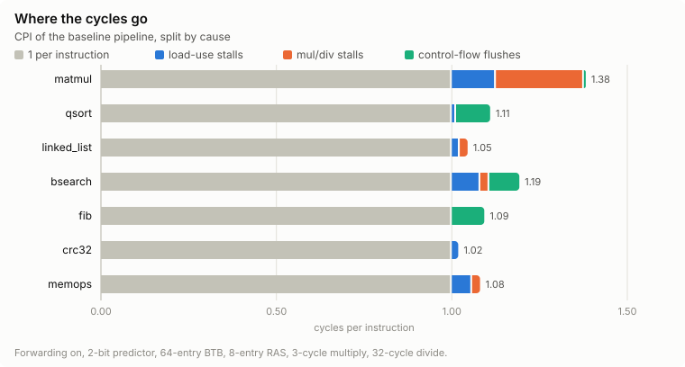
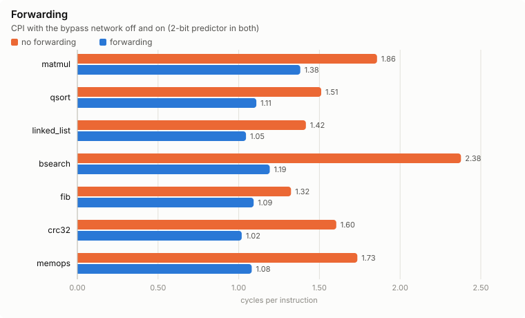
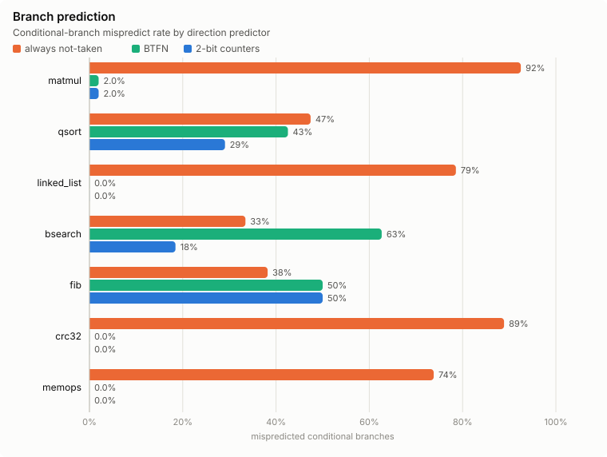

# RISC-V Pipeline Performance Analyzer

[](https://github.com/akrai37/riscv-pipeline-analyzer/actions/workflows/ci.yml)

A cycle-accurate model of a classic 5-stage in-order RV32IM pipeline, written in C++20,
used to measure how hazards and branch prediction affect throughput. It has data
forwarding, hazard detection, multi-cycle multiply and divide, branch flushing, and a
BTB with 2-bit / BTFN / not-taken direction prediction and a return address stack.

The pipeline is checked instruction by instruction, in lockstep, against a separate
sequential reference model. It is also checked against the official riscv-tests
suites and 100,000 constrained-random fuzz runs.

## Results

Seven workloads, each run under ten pipeline configurations. Every run was checked in
lockstep against the reference model. Full tables are in
[results/summary.md](results/summary.md), and
[scripts/run_experiments.py](scripts/run_experiments.py) regenerates every number and
chart on this page. CI regenerates them on each push and fails if anything differs.

- Forwarding removes **92.4%** of data-dependency stall cycles and **82.1%** of all
  stall cycles.
- Forwarding cuts the geometric-mean CPI from **1.660 to 1.126** across the seven
  workloads.
- With neither forwarding nor a direction predictor, the geometric-mean CPI is
  **1.763**.



| Workload | Instructions | Cycles | CPI | + load-use | + mul/div | + control flow | Branch mispredicts |
|---|---:|---:|---:|---:|---:|---:|---:|
| `matmul` | 918,610 | 1,269,176 | 1.382 | 0.125 | 0.251 | 0.005 | 2.0% |
| `qsort` | 661,053 | 733,296 | 1.109 | 0.012 | 0.000 | 0.097 | 29.0% |
| `linked_list` | 729,470 | 762,345 | 1.045 | 0.022 | 0.022 | 0.000 | 0.0% |
| `bsearch` | 1,558,255 | 1,857,976 | 1.192 | 0.081 | 0.026 | 0.085 | 18.4% |
| `fib` | 619,658 | 677,014 | 1.093 | 0.000 | 0.000 | 0.093 | 50.0% |
| `crc32` | 901,501 | 917,959 | 1.018 | 0.018 | 0.000 | 0.000 | 0.0% |
| `memops` | 1,059,306 | 1,144,587 | 1.081 | 0.058 | 0.023 | 0.000 | 0.0% |

The baseline configuration is: forwarding on, 2-bit predictor, 64-entry BTB, 8-entry RAS,
3-cycle multiply, 32-cycle divide. CPI = 1 + the three stall columns. Pipeline fill and
`ecall` serialization add less than 0.0001.





### What the numbers show

- **Forwarding matters most where results are used immediately.** `bsearch` halves
  its cycle count with forwarding (CPI 2.377 to 1.192). Its search loop is a single
  dependency chain: each of `sub, srli, add, slli, add, lw, beq` uses the result of the
  instruction before it. `fib` gains least (1.324 to 1.093) because its cost is in
  control flow, not data dependencies.
- **`matmul`'s largest stall is the multiplier.** The 3-cycle multiply costs 18% of
  its cycles, twice its load-use stalls. A single-cycle multiplier would take its CPI
  from 1.382 to 1.131, about as much as replacing always-not-taken with 2-bit counters
  saves it (1.627 to 1.382).
- **2-bit counters lose to always-not-taken on `fib`** (50.0% vs 38.2% mispredicts).
  Its base-case branch is taken 38% of the time, in short bursts. Two taken outcomes in
  a row push the counter just over the threshold, so the next not-taken outcome
  mispredicts as well, and the counter never reaches its strong state. On that branch
  alone, 2-bit counters mispredict 17,710 times and always-not-taken 10,946 times. These
  counts were cross-checked against an independent Python model of the predictor, fed
  the branch trace from the reference model.
- **BTFN is the worst predictor on `bsearch`** (62.7%). Clang lays the search loop out
  with its rarely-taken "key found" test as a backward branch (taken 2.9% of 116,523
  times). BTFN predicts every backward branch taken, so it misses that branch almost
  every time.
- **The return address stack only helps functions with several call sites.** With a
  single call site, the BTB's last-seen target is already right: `fib` has 28,662
  returns and 7 mispredictions without a RAS. `matmul` calls its RNG from two
  alternating sites, so every return mispredicts without a RAS (4,614 of 4,614) and
  almost none do with one (4).
- **The compiler hides `linked_list`'s load-use penalty.** It schedules the value load
  and the loop bookkeeping between each next-pointer load and its use. With forwarding
  this leaves almost no load-use stalls; without forwarding the serial chain still
  costs two cycles per step.

## Pipeline model

Classic in-order IF / ID / EX / MEM / WB, cycle-accurate for this modeled
microarchitecture ([src/pipeline.cpp](src/pipeline.cpp)):

- **Latches.** Pipeline registers are double-buffered. Every stage computes the next
  latch contents from the current ones, so one call to `cycle()` is one clock edge.
- **Register file.** It is written in the first half of a cycle and read in the second.
- **Forwarding.** EX/MEM to EX and MEM/WB to EX, plus MEM/WB to MEM for store data, so
  a load followed by a store of the loaded value does not stall. x0 is never
  forwarded and never a dependency.
- **Multiply and divide.** They hold EX for a configurable latency: 3 and 32 cycles by
  default. Operands are captured on the first cycle.
- **Branches and jumps.** They resolve in EX. Prediction happens in IF:
  - A direct-mapped BTB with full-PC tags identifies control-flow instructions and
    their targets before decode.
  - The direction predictor (2-bit pattern table, BTFN, or always-not-taken) chooses
    the direction of conditional branches.
  - A return address stack predicts returns, following the spec's x1/x5 hint table.
    It is checkpointed with every fetched instruction and restored on a
    misprediction.
- **Memory ports.** Instruction and data memory are separate ports onto one memory, so
  there is no structural hazard between IF and MEM.
- **`ecall`.** It waits in ID until older instructions have retired, then runs there,
  so a syscall never executes speculatively.
- **Faults.** They travel with the instruction and are raised only at writeback, so an
  illegal or out-of-range instruction on a mispredicted path cannot fault a correct
  program.

| Event | Cycles lost |
|---|---:|
| Dependent ALU instruction (forwarding on) | 0 |
| Load followed by a use of its result | 1 |
| Load followed by a store of its result | 0 |
| Dependent instruction, forwarding off (distance 1 / 2 / 3) | 2 / 1 / 0 |
| Multiply / divide | latency − 1 |
| Branch, correctly predicted (not taken, or taken with a BTB hit) | 0 |
| Branch mispredicted, or taken with a BTB miss | 2 |
| `jal` with a BTB hit / miss | 0 / 2 |
| `jalr` or return with a correct / wrong predicted target | 0 / 2 |

Every bubble is tagged with the cause that created it and counted when it reaches
writeback. So `cycles = instructions + lost cycles` holds exactly, and the CPI breakdown
sums with nothing left over. Each row of the table is a test in
[tests/pipeline_test.cpp](tests/pipeline_test.cpp).

`--trace` prints the pipeline one cycle per line. Here a `jal` misses the BTB in EX, the
two younger instructions become bubbles, and fetch restarts at the target:

```
      11 | 80000028 jal ra, 1240            | jal zero, -12           | addi t0, t0, 4          | sw zero, 0(t0)          | bgeu t0, t1, 16         |
      12 | -jal-btb-miss                    | jal ra, 1240            | jal zero, -12           | addi t0, t0, 4          | sw zero, 0(t0)          | flush, redirect to 0x80000018
      13 | 80000018 bgeu t0, t1, 16         | -jal-btb-miss           | -jal-btb-miss           | jal zero, -12           | addi t0, t0, 4          |
      14 | 8000001c sw zero, 0(t0)          | bgeu t0, t1, 16         | -jal-btb-miss           | -jal-btb-miss           | jal zero, -12           |
```

## Verification

| Layer | What it checks |
|---|---|
| Lockstep | Every retired instruction is compared against the reference model: PC, encoding, register write and store. At exit, the exit code, program output and register file are compared too. All 55 programs run in lockstep under four configurations on every `ctest` run. |
| riscv-tests | The official RV32UI and RV32UM suites (48 tests), through a custom environment that needs no CSRs. |
| Fuzzing | `rvsim-fuzz` generates constrained-random programs and runs each under the default configuration and a random one. See below. 50,000 programs (100,000 runs) pass with zero divergences, and CI runs them on every push. |
| Directed timing | The exact cycle cost of each hazard in the table above, each test also run in lockstep. |
| Unit tests | The decoder against `llvm-mc` encodings, instruction semantics, memory, ELF loader, predictor and RAS checkpointing. |
| Build | `-Wall -Wextra -Wconversion -Werror` with gcc and clang, and every test under ASan and UBSan. |

The fuzzer generates programs designed to stress the pipeline:
- **Dense dependencies.** Operands come from a pool of 3–6 registers, so back-to-back
  dependencies are common.
- **Memory access.** Loads and stores use a fixed base, addresses computed at run time,
  and pointer chasing.
- **Guaranteed termination.** Control flow uses only forward branches, bounded nested
  loops and calls to leaf functions.
- **Wrong-path garbage.** Indirect jumps skip over garbage words, which the pipeline
  fetches on the wrong path and must squash.
- **Faults.** Some programs end in a fault, which both models must raise on the same
  instruction.

**Does the verification catch real bugs?** [scripts/mutation_test.py](scripts/mutation_test.py)
plants seven realistic pipeline bugs, one at a time, and counts what each layer
catches (1,000 fuzz programs, 2,000 runs). Every bug is caught, and the layers
complement each other. The directed tests miss a swapped bypass priority, but the
fuzzer and the program runs catch it. An early version of the fuzzer could not
produce the second bug below, because it never used a loaded value directly as an
address; pointer chasing was added for it.

| Planted bug | Fuzz runs diverged | Program lockstep failing (of 220) | Directed tests failing |
|---|---:|---:|---:|
| Bypass priority swapped (older MEM/WB value wins) | 1,728 | 117 | 0 |
| Store base register exempt from the load-use stall | 1,686 | 3 | 1 |
| No MEM/WB → MEM store-data forwarding | 362 | 3 | 1 |
| `ecall` waits for EX but not MEM to drain | 1,976 | 220 | 21 |
| Instruction in ID not squashed on a flush | 1,996 | 216 | 8 |
| Forwarding off: hazard check ignores the MEM-stage producer | 268 | 54 | 2 |
| x0 treated as a real destination | 1,994 | 128 | 5 |

The fuzz test also found a real accounting bug. The cycle in which writeback raises a
fault was counted as a cycle but as neither a retirement nor a lost cycle, which broke
`cycles = instructions + lost` for faulting runs.

## Build and run

Needs CMake 3.20+ and a C++20 compiler. GoogleTest is fetched at configure time.

```sh
cmake -S . -B build
cmake --build build -j
ctest --test-dir build -j8                                # 399 tests

./build/rvsim --stats workloads/bin/matmul.elf            # pipeline model, CPI breakdown
./build/rvsim --lockstep workloads/bin/qsort.elf          # check against the reference model
./build/rvsim --no-forwarding --predictor not-taken --ras 0 --stats workloads/bin/fib.elf
./build/rvsim --trace workloads/bin/fib.elf 2>&1 | head   # one line per cycle
./build/rvsim --model ref workloads/bin/crc32.elf         # sequential reference model
./build/rvsim-fuzz --seeds 10000                          # differential fuzzing
python3 scripts/run_experiments.py                        # regenerate results/
python3 scripts/mutation_test.py                          # plant bugs, check they are caught
```

`rvsim --help` lists every option, including predictor, BTB, PHT and RAS sizes,
multiply and divide latency, and `--json` for machine-readable statistics.

| CMake option | Default | Effect |
|---|---|---|
| `RVSIM_WERROR` | `OFF` | Treat warnings as errors (on in CI) |
| `RVSIM_SANITIZE` | `OFF` | Build with ASan and UBSan |
| `RVSIM_BUILD_TESTS` | `ON` | Build the test suite |

## Programs

All programs are static RV32IM ELF executables loaded at `0x80000000`. Prebuilt
binaries are committed, so nothing needs a RISC-V toolchain. To rebuild them you need
clang with the RISC-V backend and `ld.lld`:

```sh
make -C workloads          # workloads/bin/ and tests/riscv-tests/bin/
make -C workloads host     # build the workloads natively and run them
```

CI also rebuilds every program with a different clang version and runs the result, so
the sources cannot drift from the committed binaries.

**Workloads** ([workloads/](workloads/)). Each workload checks its own result and exits
with the number of failed checks. Expected values either don't depend on the code (the
CRC-32 check value, closed-form sums) or come from a native build of the same source
(`make host`).

| Workload | What it stresses |
|---|---|
| `matmul` | 48×48 integer matrix multiply: loaded values feeding `mul` |
| `qsort` | Quicksort of 4,000 random keys: data-dependent branches |
| `linked_list` | Pointer chasing through a shuffled list: a serial load-to-load chain |
| `bsearch` | 10,000 binary searches: hard-to-predict branches |
| `fib` | Recursive Fibonacci: calls, returns, stack traffic |
| `crc32` | Bitwise CRC-32 over 16 KiB: long ALU dependency chains |
| `memops` | Transform-copy, `memset`, `memcmp`, `strlen` over large buffers |

**riscv-tests** ([third_party/riscv-tests/](third_party/riscv-tests/)). The official
suites run through [tests/riscv-tests/env/riscv_test.h](tests/riscv-tests/env/riscv_test.h),
which replaces the upstream machine-mode environment and reports through the exit
syscall. `fence_i` and `ma_data` are not run;
[VENDORED.md](third_party/riscv-tests/VENDORED.md) explains why.

## Limitations

- **No memory hierarchy.** Memory has a fixed 1-cycle latency, with no caches or TLB,
  so memory-bound behaviour is not modeled.
- **User mode only.** There are no CSRs, interrupts or privilege modes, and a fault
  stops the simulation instead of trapping.
- **Unsupported instructions and accesses.** Misaligned accesses fault, and there is no
  `fence.i` (so no self-modifying code) and no compressed (C) instructions.
- **Branch timing.** Every branch and jump resolves in EX. A real core would usually
  resolve `jal` in ID for a 1-cycle penalty.
- **Single issue, in order.**
- **Small workloads.** They are short kernels of 0.6–1.6M instructions, chosen to
  isolate one behaviour each, not a standard benchmark suite.
- **"Cycle-accurate" means accurate for this modeled microarchitecture**, not
  calibrated against a specific silicon core.

## Repository layout

```
include/rvsim/, src/   decoder, semantics, memory, ELF loader, reference model,
                       pipeline, predictor, lockstep checker, fuzzer
src/main.cpp           rvsim command-line tool
tools/fuzz_main.cpp    rvsim-fuzz
tests/                 GoogleTest suites and the riscv-tests environment
workloads/             workload sources, runtime, linker script, prebuilt binaries
third_party/           vendored riscv-tests sources
scripts/               experiments and mutation testing
results/               generated results and charts
```

## License

MIT, see [LICENSE](LICENSE). The vendored riscv-tests are BSD-3-Clause.
